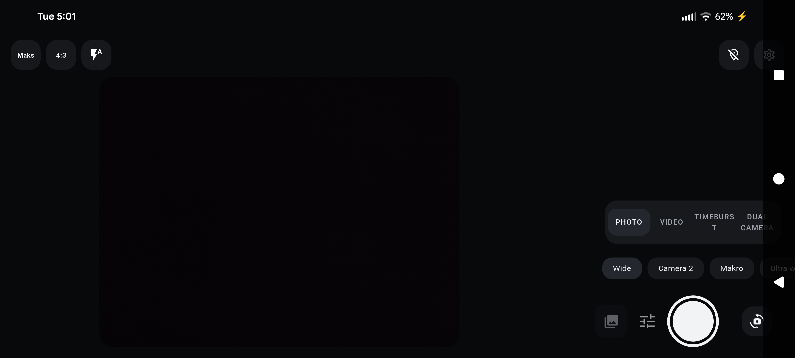

<div align="center">
  

# Kadrixa

**A camera app made for the shot you want.**

Compose, capture, and review with hands-on controls for photos and video.

[](https://github.com/kargalar/kadrixa/releases/latest) [](https://github.com/kargalar/kadrixa/releases/latest) [](LICENSE)

[Download for Android ↓](https://github.com/kargalar/kadrixa/releases/latest) · [Build from source](#build-from-source) · [Report an issue](https://github.com/kargalar/kadrixa/issues)

</div>



## Frame the shot, then make it yours

Choose a capture mode, select a lens and aspect ratio, and tune the camera before pressing the shutter. Review and manage your media from the built-in gallery.

## Features

- Capture photos and video with manual focus, exposure, zoom, and lens selection.
- Record front and rear cameras together in dual-camera mode.
- Create timeburst clips with configurable intervals and duration.
- Review, share, and manage media in the local gallery.
- Add location metadata and monitor microphone audio levels.
- Process long recordings in the background.

## Download and install

Get the latest Android APK from [GitHub Releases](https://github.com/kargalar/kadrixa/releases/latest), download it to your device, and open the APK to install Kadrixa.

## Build from source

Requirements: Flutter, the Android SDK, and a configured Android toolchain.

```sh
flutter pub get
flutter analyze
flutter test
flutter build apk --release
```

## License

Kadrixa is licensed under the GNU General Public License v3.0. See [LICENSE](LICENSE).
